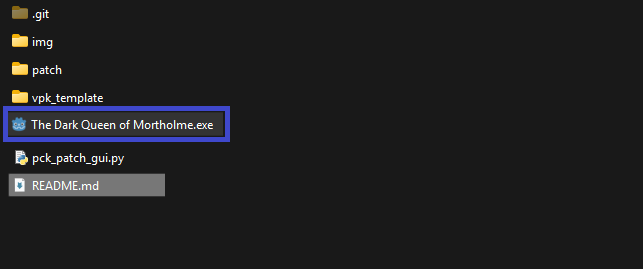
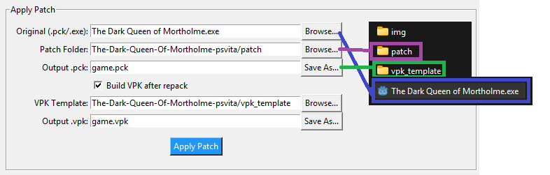
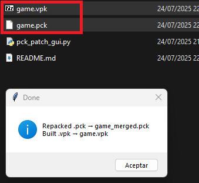
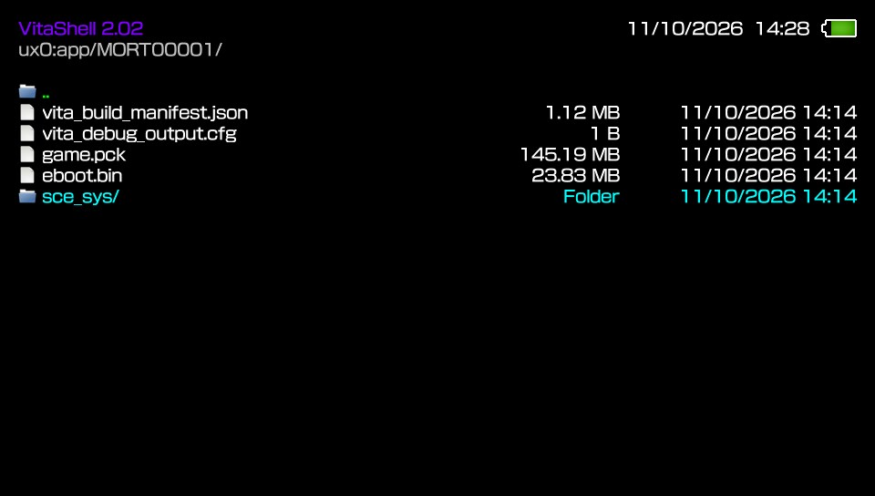
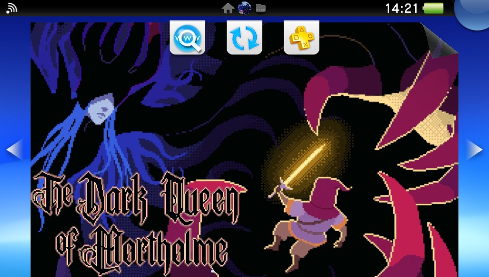
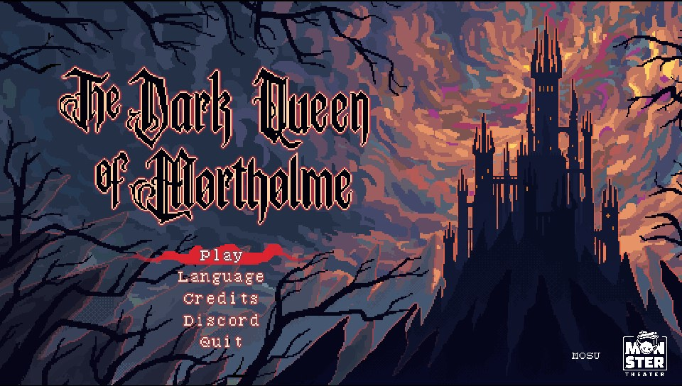
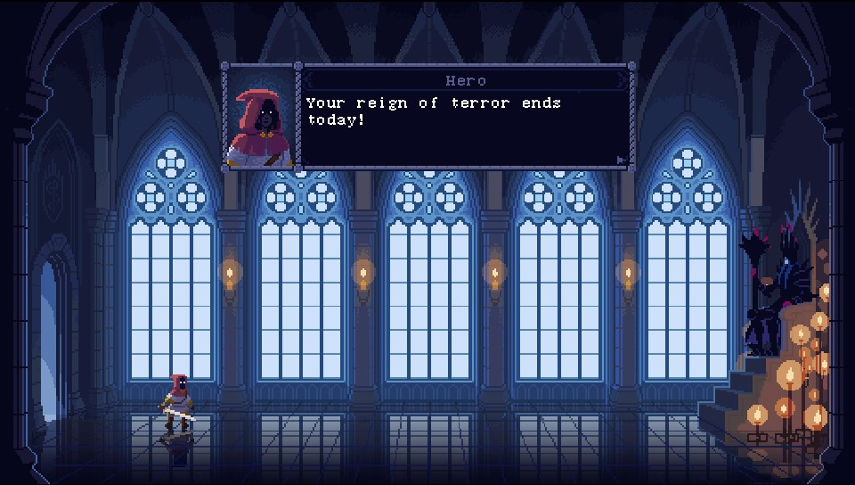
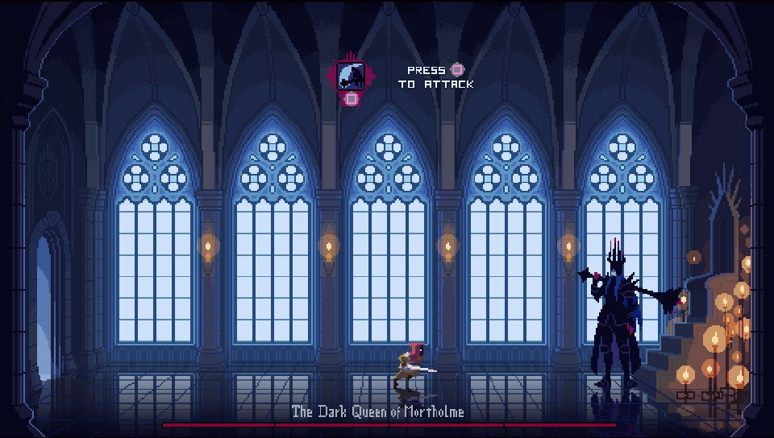
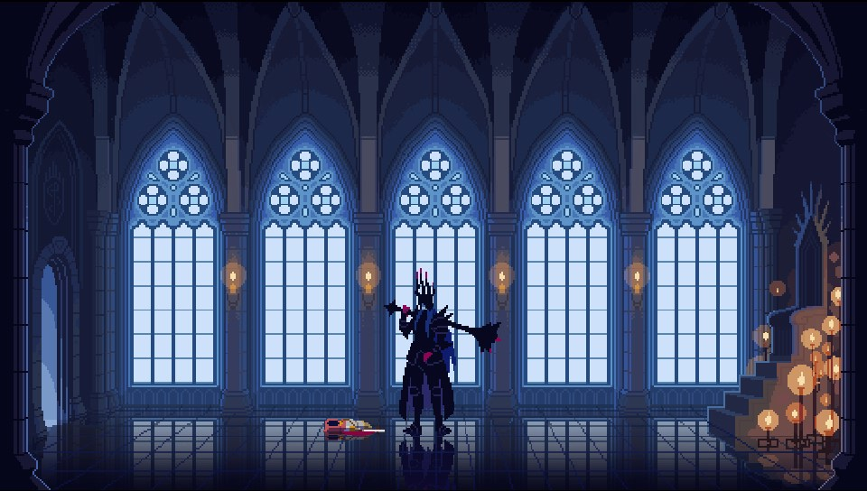
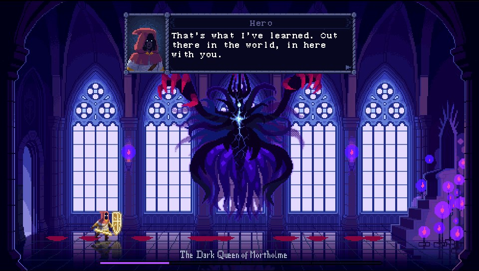

# The Dark Queen Of Mortholme — PSVita Patch

**A patch for _The Dark Queen Of Mortholme_ to run on the PlayStation Vita.**  
**The Dark Queen Of Mortholme** is a game where you play as the Dark Queen—the most powerful being of your entire universe. Your lair is breached by an aspiring hero—a pitiful thing, easily crushed.

Except they keep coming back.

A 20 minute anti-game about an unconventional relationship and the capacity for change.

---

## 🌐 Official Game Download

- [Steam](https://store.steampowered.com/app/3587610/The_Dark_Queen_of_Mortholme/)  
- [itch.io](https://qwertyprophecy.itch.io/mortholme)  

---

## 🎮 PSVita Patch Installation Guide

### 1. Download Required Files
- Get the windows version of the game from [Steam](https://store.steampowered.com/app/3587610/The_Dark_Queen_of_Mortholme/)  
- Clone or download this **PSVita patch repository**.

### 2. Prepare the Game Files
- Locate `The Dark Queen Of Mortholme.exe` in the downloaded game folder.
- Place it inside the patch repository folder.



### 3. Run the Patch Script

Using **Python 3**, execute the following command or double click it to execute it:

```bash
python pck_patch_gui.py
```

Set up the following paths and press **Apply Patch**



Once completed, you'll see:



### 4. Install on Your PSVita

You now have two options:

- **Install via VPK:**  
  Use **VitaShell** to install the generated `game.vpk`.

- **Manual Install:**  
  - Download the game from **VitaDB**.  
  - Place the `game.pck` file in `ux0:app/MORT00001/`.





---

## Changelog v1.00:
- First release.
- The some shaders have been disabled.
- Reflections are enabled.
  
---

## 📸 Screenshots

 
 
  



## Credits

- [Mosu](https://store.steampowered.com/search/?developer=Mosu) for creating the original game.
